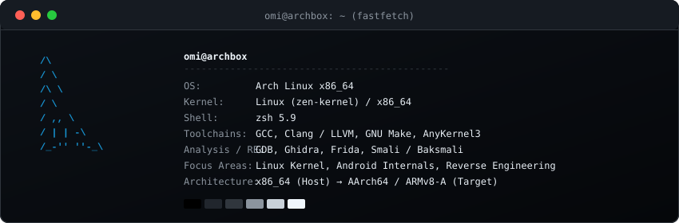

<div align="center">

  <!-- Header Banner -->
  

  <br/><br/>

  <!-- Social Navigation Badges -->
  <a href="https://github.com/omi4real">
    
  </a>
  <a href="https://t.me/omi4real">
    
  </a>
  <a href="https://xdaforums.com">
    
  </a>
  <a href="mailto:contact@omi.dev">
    
  </a>

</div>

<br/>

### 🛸 About Me


```text
> whoami
Systems Engineer & Security Researcher • Reverse Engineering • Linux Kernel • AOSP
```

- 🛡️ **Reverse Engineering & Vulnerability Research**: Firmware extraction, cryptographic analysis (AES/Scrypt/RSA), TrustZone/TEE Keymaster blob unwrapping, BootROM (BROM) exploitation, and Smali bytecode disassembly.
- ⚡ **Linux Kernel Engineering**: Subsystem driver tuning, dynamic MIPI DSI PLL clock modulation via debugfs, AnyKernel3 packaging, and Device Tree Source (DTS) configuration.
- 📱 **Android Internals & AOSP**: Custom ROM architecture, Hardware Abstraction Layer (HAL) bring-ups, vendor partition reconstruction, and Magisk / Zygisk systemless instrumentation.

<br clear="right"/>

---

### 🛠️ Core Engineering Stack

<div align="center">

  <!-- Languages -->
  
  
  
  
  

  <br/>

  <!-- Systems & Platforms -->
  
  
  
  

  <br/>

  <!-- Analysis & Security -->
  
  
  
  

  <br/>

  <!-- Android & Firmware Toolchain -->
  
  
  

</div>

---

### 💻 System Telemetry

<div align="center">
  
</div>

---

### 🚀 Selected Engineering Projects

<table>
  <tr>
    <td width="50%">
      <b><a href="https://github.com/omi4real/Realme-Narzo-30A-Display-OC-Toolkit">MIPI DSI Overclock &amp; AnyKernel3 Engine</a></b>
      <br/>
      <i>Automated display subsystem overclocking toolkit leveraging dynamic debugfs MIPI PLL clock modulation (zero reboot) and AnyKernel3 boot image patch generation.</i>
    </td>
    <td width="50%">
      <b><a href="https://github.com/omi4real/walton-primo-gm3-forensics">Hardware Forensics &amp; FDE Decryption</a></b>
      <br/>
      <i>eMMC hardware forensics, BootROM (BROM) USB bypass, TrustZone/TEE Keymaster blob unwrapping, and offline Scrypt + RSA signature cryptographic derivation.</i>
    </td>
  </tr>
  <tr>
    <td width="50%">
      <b><a href="https://github.com/omi4real/Realme-Narzo-30A-RMX3171-AOSP-Device-Tree">AOSP Device Tree &amp; HAL Bring-Up</a></b>
      <br/>
      <i>Hardware-calibrated AOSP device tree, proprietary vendor HAL adaptation, and kernel configuration for MediaTek MT6769V (Helio G85).</i>
    </td>
    <td width="50%">
      <b><a href="https://github.com/omi4real/Realme-Narzo-30A-RMX3171-keepQASSA-Unofficial">Unofficial Android 10 (Q) ROM Port</a></b>
      <br/>
      <i>Custom AOSP-based Android 10 ROM port with framework smali bytecode patches, thermal recalibration, and battery lifecycle optimization.</i>
    </td>
  </tr>
</table>

---

<div align="center">
  <sub><code>/* code low, build clean, push silent */</code></sub>
</div>
