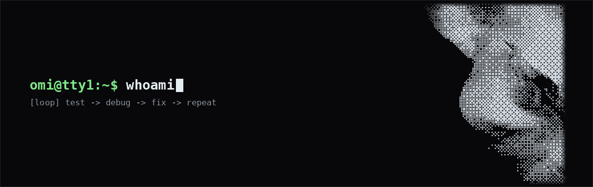

<div align="center">
  
  <br/><br/>
  <a href="https://t.me/ninjagoshe"></a>&nbsp;&nbsp;&nbsp;<a href="mailto:labibmostafa999@gmail.com"></a>
</div>

<br/>

```sh
omi@tty1:~$ whoami
omi (@omi4real)
linux & android developer.
living in open terminals—
testing, debugging & fixing
software at the system level.

omi@tty1:~$ cat /etc/focus
[systems]
  linux os & shell scripting
  cli tooling & automation

[android]
  custom rom dev & porting
  system apps & root modules

[low-level]
  os optimization & debugging
  hardware & audio tuning

omi@tty1:~$ cat /proc/loop
while true; do
  test || debug && fix
done
```
