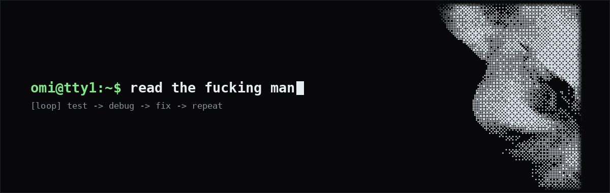

<div align="center">
  
  <br/><br/>
  <a href="https://t.me/ninjagoshe">
    
  </a>
  <a href="mailto:labibmostafa999@gmail.com">
    
  </a>
</div>

<br/>

```sh
omi@tty1:~$ whoami
omi (@omi4real)
systems tinkerer & android rom developer.
spending most hours in open terminals:
testing, debugging, and fixing things at
the framework and kernel level.

omi@tty1:~$ cat /etc/capabilities
[systems]
  linux administration, posix shell
  automation, init daemons & runtime
  service scripting

[android]
  custom rom development & device porting,
  aosp framework & bytecode patching,
  vendor hal integration & sepolicy debugging

[low-level]
  kernel parameter tuning, sysfs/procfs
  governance, audio & power subsystem
  calibration

omi@tty1:~$ ls -la ~/workspace/
drwxr-xr-x  keepQASSA-Unofficial/
  └─ android 10 os port & device bringup
  └─ framework patches, hal & thermal tuning

drwxr-xr-x  Magisk-Addons/
  └─ systemless root & kernel tuning suite
  └─ alsa register routing, schedutil & i/o

drwx------  staging/
  └─ local trees & automation scripts
     [private]

omi@tty1:~$ while true; do
>   test_build || debug_logcat
>   patch_subsystem && verify_runtime
> done
```
