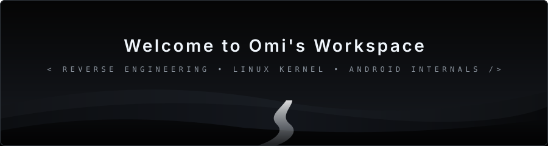

<div align="center">

  <!-- Dithered Halftone Terminal Banner -->
  

  <br/><br/>

  <!-- Minimal Monochrome Navigation -->
  <a href="https://github.com/omi4real">
    
  </a>
  <a href="https://t.me/omi4real">
    
  </a>
  <a href="https://xdaforums.com">
    
  </a>
  <a href="mailto:contact@omi.dev">
    
  </a>

</div>

<br/>

```bash
omi@archbox:~$ whoami
```

> **omi** (`@omi4real`)  
> Systems tinkerer & Android ROM maintainer. Daily driving Linux, spending most waking hours in open terminals: testing, debugging, and fixing things that shouldn't be broken.

```bash
omi@archbox:~$ cat /etc/runtime.conf
```

```text
[ENGINEERING LOOP]
while [ $DEVICE_ALIVE -eq 1 ]; do
    test_build      || debug_logcat
    patch_subsystem || fix_smali
    flash_partition || reset_recovery
    # loop: test -> debug -> fix -> repeat
done
```

```bash
omi@archbox:~$ cat /var/log/focus.log
```

- 📱 **Android Custom ROM Porting**: Maintaining `#keepQASSA` (Android 10 Q) as an uncompromising daily driver—stripping OEM bloat, calibrating thermal profiles, and tuning power governors for 6000mAh battery endurance.
- 🔊 **Hardware Subsystem Calibration**: Direct register manipulation on MediaTek audio codecs (MT6358 / SIA8101), locking analog ALSA mixer stages, and synchronizing 180Hz gaming touch sampling rates.
- ⚡ **Kernel & Root Governance**: Authoring hardware-specific Magisk suites, Schedutil CPU governor latency reduction (500μs), MediaTek GED GPU boosts, and eMMC 5.1 deadline I/O schedulers.

```bash
omi@archbox:~$ which toolchain
```

<div align="center">

  <!-- Core Languages -->
  
  
  
  

  <br/>

  <!-- Systems & Platforms -->
  
  
  
  

</div>

```bash
omi@archbox:~$ ls -la ~/public-deployments/
```

| Repository | Role & Subsystems | Status |
| :--- | :--- | :--- |
| **[`Realme-Narzo-30A-RMX3171-keepQASSA-Unofficial`](https://github.com/omi4real/Realme-Narzo-30A-RMX3171-keepQASSA-Unofficial)** | Unofficial Android 10 (Q) Daily Driver ROM port. Stripped OEM bloat, optimized thermal governors, and extreme battery lifecycle endurance. | `Daily Driver` `Stable` |
| **[`Realme-Narzo-30A-Magisk-Addons`](https://github.com/omi4real/Realme-Narzo-30A-Magisk-Addons)** | Hardware-calibrated root suite: MT6358 ALSA codec unlocking, 180Hz gaming touch sampling, Schedutil CPU latency tuning, and eMMC 5.1 deadline I/O. | `Verified` `Active` |

```bash
omi@archbox:~$ cat ~/.signature
```

```text
omi@archbox:~$ read the manual █
```
